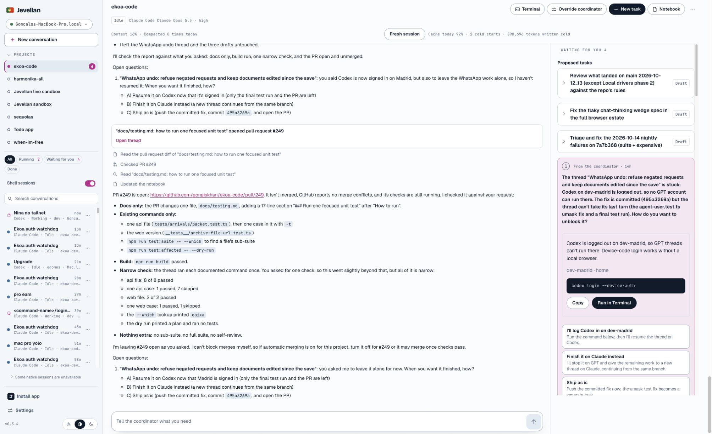
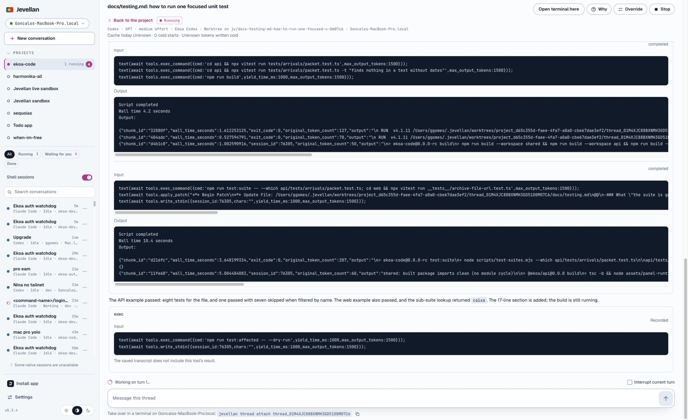

# Small coordinator task check — 14 October 2026

Live operational repair on Jevellan0.3.4 (source checkpoint a01328be). This is a narrow usability check, separate from the earlier readiness report. It is not owner acceptance or a full-suite pass.

## What was fixed

Madrid still ran0.3.2 while the Pro hub ran0.3.4. Parsing the live hub settings with the old member failed on `sessionCheckpoints`, causing “The hub returned an invalid response.” The existing member was updated through the normal installer to the verified0.3.4 package, retaining a complete cold backup, membership and isolated authentication. The same live settings now parse successfully. The member user service is active on0.3.4. No application source change was necessary.

## Quick check

One small task was sent through the Ekoa Projects coordinator chat, asking for documentation showing a focused unit test. The coordinator queued it; Jev selected Codex GPT-6 Astra, medium effort, and the Pro; the task entered Preparing, Running, then Publishing in a fresh worktree. Only `docs/testing.md` changed:17 added lines. The build and focused API/web tests passed. No full test suite or self-review ran.

The earlier two owned readiness requests were stopped/cancelled with history retained. Unrelated WhatsApp work and the three existing drafts were preserved. Automatic merging remains off; no project setting changed.

**Live result:** [PR #249](https://github.com/gongiskhan/ekoa-code/pull/249) opened automatically, with only17 added documentation lines. The configured publication gate (shared build, typecheck and lint) passed. GitHub’s normal `result` check started; it runs lint, gates, typecheck and builds on GitHub-hosted ubuntu-latest under the existing Ekoa workflow. CI was still running at this evidence checkpoint. No merge occurred and GitHub auto-merge is disabled. The builder shortened the PR description and removed its placement attribution; code and test evidence were unchanged.

## Focused verification and limits

- **Live:** before/after settings parse, installed member service and identity/auth preservation, real coordinator turn and Codex worktree, build and focused test commands. See `evidence.json`.
- **Simulated:** combined queue/schema test run:85passed,1failed. Queue tests pass. An existing schema test lacks a payload for one registered ledger event; it is recorded rather than hidden or fixed in this operational repair.
- **Not run:** broad backend/browser suites and new nightly/cache scenarios; the owner requested a quick check of the simple task-to-PR path. Earlier failed readiness results remain unchanged.

## How the owner checks it

1. Reload Jevellan, open Projects → ekoa-code.
2. Send: “Start one small task now: [describe one change]. Run a build and the relevant narrow test, then open a PR. Leave it open.”
3. Open its card under Running to see its transcript; Why shows the placement. The result appears under Pull requests with its check status.

Settings changed and restored: none. Ekoa automatic merging remains off.
